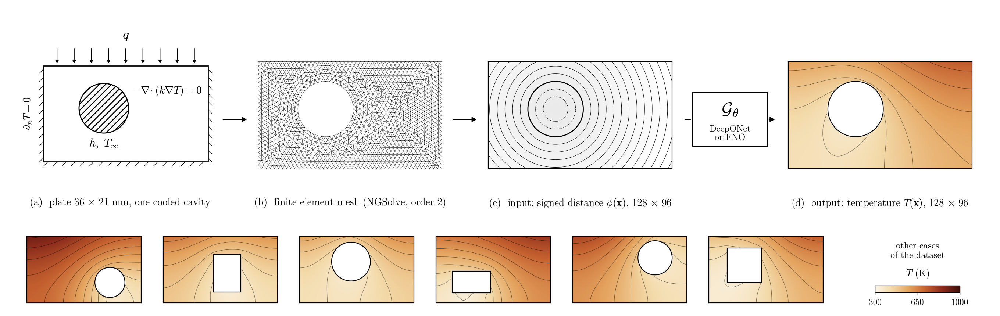

# DeepONet and FNO surrogates for steady heat conduction in a plate with a cavity



This repository compares two neural operators that learn the map from cavity geometry to temperature field:

- the **DeepONet** of Lu et al. (2021)
- the **Fourier Neural Operator (FNO)** of Li et al. (2021)

Both are trained on finite element solutions computed with NGSolve.

The repository contains everything needed to:

1. generate the finite element dataset;
2. tune both operators on validation data only;
3. measure how their test error falls as the number of training cases grows (the data-size study);
4. produce the comparison figures and tables.

One program, `run.py`, does all of it. It runs on a laptop, on a workstation with an NVIDIA GPU, and on a Slurm cluster.

---

## The problem

<p align="center"><i>−∇·(k ∇T) = 0 in a 36 mm × 21 mm plate with one cooling cavity</i></p>

**Plate and loads**

| Item | Value |
|---|---|
| Top edge | heat flux q = 0.5 MW/m² enters |
| Cavity wall | convection −k ∂T/∂n = h (T − T∞), h = 4000 W/(m² K), T∞ = 300 K |
| Other edges | adiabatic |
| Material | k = 28.3 W/(m K) |
| Cavity | circle (diameter 8–14 mm) or rectangle (8–14 mm × 6–12 mm), anywhere in the plate |

**Reference solutions and network data**

- Reference solutions use H1 finite elements of order 2 (NGSolve), sampled on a 128 × 96 grid.
- Network input: the signed distance field (SDF) of the cavity on that grid.
- Network output: the temperature on the same grid.

**The data-size study** uses a single dataset of 3800 finite element cases:

| Part | Cases | Sampling | Role |
|---|---|---|---|
| Training pool | 3200 | Halton sequence | the training set of size N is the first N cases, so the sets are nested |
| Validation | 200 | Latin hypercube | the same for every N; used for early stopping and tuning |
| Test | 400 | Latin hypercube | the same for every N; used only for final errors |

Both operators are trained at N = 200, 400, 800, 1600 and 3200, with five seeds each. A power law e = C·N^(−α) is fitted to the test error.

---

## What is in the repository

| Folder | Contents |
|---|---|
| `run.py` | the only entry point: `python run.py STAGE OPTIONS` |
| `src/fem/` | geometry and SDF, mesh, weak form, sampling of one FE case on the grid |
| `src/data/` | Latin-hypercube and Halton datasets, frozen split, train-only scaling, rounded-rectangle test set |
| `src/models/` | DeepONet, FNO, named variants |
| `src/training/` | training loop, checkpoints and resume, tuning stages, data-size runs |
| `src/analysis/` | error metrics, timing, mesh check, all figures and reports |
| `src/config.py` | every fixed setting (physics, geometry ranges, grid, defaults), each with a comment |
| `jobs/slurm/` | `gpu.sh` and `cpu.sh`: one generic Slurm job each |
| `tests/` | numerical regression tests (`python tests/run_all.py`) |
| `docs/manual/` | **the step-by-step instructions** (see "Documentation" below) |
| `archive/` | earlier scripts (POD-DeepONet, depth study, old figures); not used, not runnable as is |

The code creates two more folders:
- `data/` holds the datasets.
- `outputs/` holds models, logs, tables and figures.

Neither is part of the repository.

---

## Documentation: three files, one per way of running

| File | For |
|---|---|
| `docs/manual/commands_windows.txt` | a **Windows** computer with an NVIDIA GPU (Anaconda Prompt) |
| `docs/manual/commands_slurm.txt` | a **Slurm cluster** (written on Sunbird, Supercomputing Wales) |
| `docs/manual/Operator_Learning_Manual.tex` | the full manual, as LaTeX: set-up, every step, every option, troubleshooting. Compile with `pdflatex` twice |

The two command files are written to be run from top to bottom:
- **Command lines:** every command line can be copied as it is.
- **Notes:** every note line explains the line below it.
- **Pasting notes is safe:** notes start with `rem` (Windows) or `#` (Linux), so pasting them does nothing.

On Linux or macOS without a cluster, use the commands of this README. They are the Windows commands with `python run.py ...` unchanged.

---

## 1. Installation

You need Python 3.11 and four packages: `numpy`, `matplotlib`, `ngsolve` and `torch` (see `requirements.txt`). A GPU is optional, but training is much faster with one.

### Linux, macOS, or Ubuntu inside Windows (WSL)

```bash
# Miniforge, if conda is not installed yet (Linux; macOS installers on the same page)
curl -L -O https://github.com/conda-forge/miniforge/releases/latest/download/Miniforge3-Linux-x86_64.sh
bash Miniforge3-Linux-x86_64.sh -b -p ~/miniforge3
source ~/miniforge3/etc/profile.d/conda.sh

   # the project, in your home folder (never in the folder the terminal happened to open in)
   cd ~
   git clone https://github.com/prajwal1798/Feature_Extraction.git ML
   cd ~/ML
   pwd                     # must print /home/<your name>/ML

# a separate environment for it
conda create -n opl python=3.11 -y --override-channels -c conda-forge
conda activate opl
python -m pip install -r requirements.txt
```

On Linux, `pip install torch` installs the CUDA build. On macOS, use `--device cpu` (see section 2).

### Windows with an NVIDIA GPU

Follow blocks 1–6 of `docs/manual/commands_windows.txt`:

1. Check the NVIDIA driver with `nvidia-smi`. Only the driver is needed, not the CUDA Toolkit.
2. Install Miniconda.
3. Create the environment.
4. Install the CUDA build of PyTorch:
   ```bat
   pip install torch --index-url https://download.pytorch.org/whl/cu130
   ```
   Use `cu126` if `nvidia-smi` reports CUDA 12.6–12.9.
5. Check that the GPU is visible.

### Slurm cluster

Follow blocks 0–2 of `docs/manual/commands_slurm.txt`:

1. Clone into `/scratch/$USER/ML`.
2. Create the environment inside the project folder as `ML/env`.
3. Edit the cluster lines at the top of `jobs/slurm/gpu.sh` and `jobs/slurm/cpu.sh`: `--account`, `--partition`, and the GPU type.

---

## 2. Check the installation

```bash
python tests/run_all.py          # numerical tests, about one minute: "All tests passed"
python run.py smoke              # every stage on 20 tiny cases: "Smoke test passed"
```

Its files go to `verification/`, which can be deleted afterwards.

**Without an NVIDIA GPU:** `run.py` uses the GPU by default (`--device cuda`). On a computer without one, add `--device cpu` to every training, tuning, evaluation and plotting command. Data generation always runs on the CPU.

---

## 3. The full study, step by step

Every command is typed in the project folder. Each step needs the results of the one before.

**Step 1–2: data** (CPU; minutes to an hour, depending on the processor; restartable: type it again)

```bash
python run.py generate --family scaling                          # 3800 FE solves
python run.py generate-rounded --family scaling --rounded-cases 50  # rounded rectangles, never trained on
python run.py plot-sampling --family scaling                     # where the cavities lie
python run.py preview                                            # one case: geometry, mesh, field, SDF
python run.py mesh-check                                         # FE accuracy on three meshes
```

**Step 3: one quick model** (optional; checks that training works)

```bash
python run.py train    --family scaling --train-size 800 --operator fno --seed 321 --run-name try_fno --epochs 300
python run.py evaluate --family scaling --operator fno --run-name try_fno
python run.py plot     --family scaling --operator fno --run-name try_fno
```

**Step 4: tuning at N = 800** (validation cases only; each stage starts from the winner of the one before, so keep the order)

```bash
T="--family scaling --train-size 800"

python run.py tune        $T --operator deeponet --stage-name grid      --epochs 2000
python run.py tune-select $T --operator deeponet --stage-name grid
python run.py tune        $T --operator deeponet --stage-name grid_gelu --epochs 2000
python run.py tune-select $T --operator deeponet --stage-name grid_gelu
python run.py tune        $T --operator deeponet --stage-name lr        --epochs 2000
python run.py tune-select $T --operator deeponet --stage-name lr

python run.py tune        $T --operator fno --stage-name modes_width --epochs 2000
python run.py tune-select $T --operator fno --stage-name modes_width
python run.py tune        $T --operator fno --stage-name depth       --epochs 2000
python run.py tune-select $T --operator fno --stage-name depth
python run.py tune        $T --operator fno --stage-name lr          --epochs 2000
python run.py tune-select $T --operator fno --stage-name lr
```

| Operator | Stage | What changes | Models |
|---|---|---|---|
| DeepONet | `grid` | layers L ∈ {2,4,6,8,10} × neurons N ∈ {10,20,40,80,160}, branch and trunk alike; tanh | 25 |
| DeepONet | `grid_gelu` | the same 25 with GELU | 25 |
| DeepONet | `lr` | learning rate ∈ {3e-4, 1e-3, 3e-3} at the better grid winner | 3 |
| FNO | `modes_width` | Fourier modes ∈ {4,8,12,16} × width ∈ {16,32,64}; 4 blocks | 12 |
| FNO | `depth` | Fourier blocks ∈ {2,3,4,6} | 4 |
| FNO | `lr` | learning rate ∈ {3e-4, 1e-3, 3e-3} | 3 |

How tuning is run and selected:
- **Fair comparison:** all models of a stage share the split, the epoch budget, early stopping and the scheduler. `tune-select` refuses to compare models where these differ.
- **Selection:** the winner has the lowest mean validation relative L2 error. RMSE and R² are reported alongside.
- **Restartable:** if `tune` stops, type it again. Finished models are skipped.

**Step 5: the data-size runs** (5 sizes × 5 seeds = 25 runs per operator, each scored on the 400 test cases)

```bash
python run.py train-scaling --operator deeponet
python run.py train-scaling --operator fno
```

**Steps 6–8: results**

```bash
python run.py scaling-report                                   # error against N, fitted alpha
for n in 200 400 800 1600 3200; do
    python run.py compare --family scaling --train-size $n     # full DeepONet-FNO report at each N
done
R="--family scaling --operator fno --run-name scale_fno_N3200_seed321"
python run.py plot $R                                          # loss curve and one test case
python run.py evaluate-rounded $R                              # errors on the rounded rectangles
python run.py benchmark $R                                     # training and prediction times
```

The equivalent Windows lines, with `set` and `for %n in (...)`, are in `commands_windows.txt`. The cluster versions of the same steps are in `commands_slurm.txt`.

---

## 4. On a Slurm cluster

The words after the job file are those you would type after `python run.py`:

```bash
sbatch jobs/slurm/cpu.sh generate --family scaling                       # CPU node
sbatch jobs/slurm/gpu.sh train --operator fno --seed 321                 # one GPU
```

A tuning stage or the data-size study runs as a **job array**. Every task trains one model on its own GPU, and all of them run at the same time:

```bash
T="--family scaling --train-size 800 --operator deeponet"
sbatch --array=0-24 --output=outputs/slurm/gpu_%A_%a.out jobs/slurm/gpu.sh tune $T --stage-name grid --epochs 2000
sbatch jobs/slurm/cpu.sh tune-select $T --stage-name grid       # when the array has finished
```

How a task knows which model to train:
- **Tuning:** `run.py` reads `SLURM_ARRAY_TASK_ID` and trains cell k of the stage.
- **`train-scaling`:** task k trains size k ÷ 5 with seed k mod 5.

Watching jobs:

| Command | Shows |
|---|---|
| `squeue -u $USER` | waiting (`PD`) and running (`R`) jobs |
| `tail -F outputs/slurm/gpu_ARRAY_TASK.out` | one task's output, live |
| `sacct -j NUMBER` | whether a job `COMPLETED`, `FAILED` or hit `TIMEOUT` |

Each output file starts with the job number, node and command. It ends with the exit code; 0 means success.

---

## 5. Where the results go

`TAG` is `scaling_3200` for the data-size study, or `combined_0500` for the 500-case Latin-hypercube dataset (the default without `--family`). `RUN` is the run name.

| What | Where |
|---|---|
| dataset | `data/processed/TAG/protocol_v2/dataset.npz` |
| trained model | `outputs/checkpoints/TAG/RUN/best_model.pt` |
| loss history, training summary | `outputs/logs/TAG/RUN/` |
| test (or validation) errors | `outputs/study_results/TAG/RUN/` |
| figures of one run | `outputs/figures/TAG/RUN/` |
| tuning tables and winners | `outputs/study_results/TAG/tuning/` |
| tuning heatmaps | `outputs/figures/TAG/report/` (data-size study: `report/N0800/`) |
| learning curves, fitted α | `outputs/figures/scaling_3200/report/scaling.pdf`, `scaling.csv`, `scaling_rates.json` |
| DeepONet-FNO report at size N | `outputs/figures/scaling_3200/report/N0200/` … `N3200/` |

Figures are saved as PDF and 600 dpi PNG. The numbers behind every figure are saved next to it as CSV or JSON.

---

## 6. Options and settings

Every option of `run.py` has a default; type an option only to change it. `python run.py --help` lists them. The manual (section "All options") explains each one.

Settings that define the problem have no option on purpose. These are the physics, the cavity ranges, the mesh, the grid and the split seeds. They live in `src/config.py`, each with a comment. Changing one means generating the data again (`--force`).

Stopping and continuing:
- **`train` and `train-final`:** a recovery point is saved every 50 epochs. Type the same command again with `--resume`.
- **`tune`, `train-scaling` and `generate`:** type the same command again; finished work is kept.

---

## 7. Reproducibility

- **Numerics:** FP32 throughout, TF32 off, deterministic algorithms on. The same seed on the same machine gives the same numbers.
- **Data checks:** the split, the temperature scaling (from training cases only) and a SHA-256 fingerprint of the dataset are stored with the data. Every checkpoint and tuning table is checked against them.
- **One process per stage:** NGSolve and PyTorch are never imported in the same Python process (together they crash). `run.py` keeps them in separate stages, and `tests/run_all.py` runs each test file in its own process.

---

## Citation and licence

If you use this code, please cite the accompanying publication (to be added). The code is released under the GNU General Public License v3.0 (`LICENSE`).
